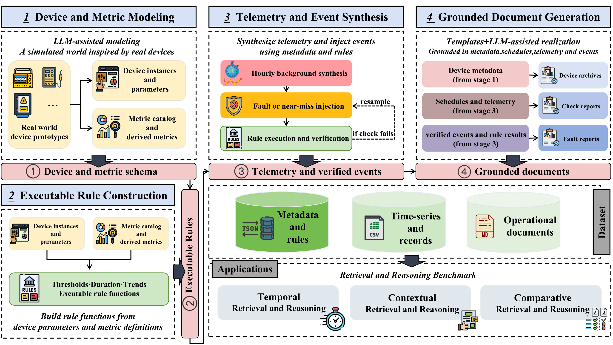
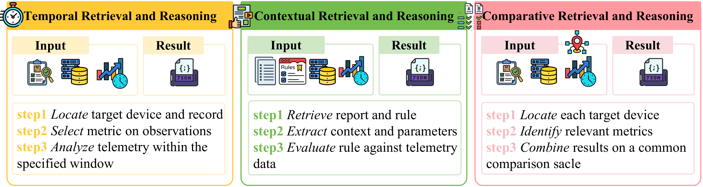
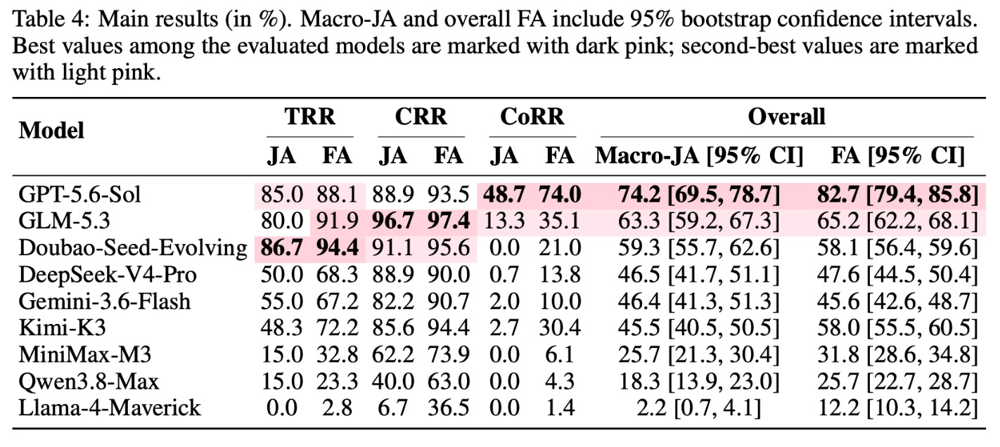
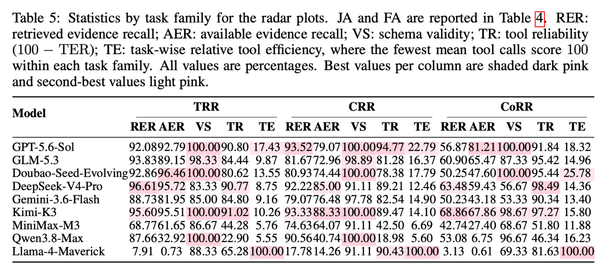
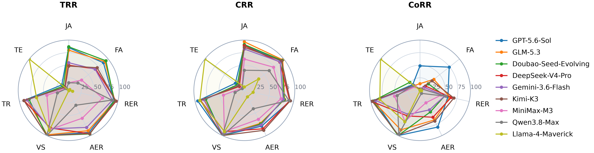

# ⚡ PowerBench:A Benchmark for Agentic Retrieval and Reasoning in Power Systems

<p align="center">
  
  
  
  
  
</p>

<p align="center">
  
</p>

<p align="center">
  <em>Overview of PowerBench. All data modalities come from the same structured state. Executable rules are used both to build the data and to verify the ground truth. Benchmark questions ask models to retrieve and combine evidence from that world and to reason over it.</em>
</p>

PowerBench comprises (1) a **generation framework** that derives interconnected heterogeneous operational data through a **common dependency chain**, and (2) a **synthetic dataset** generated by this framework.

Building on that dataset, we construct **300 questions** across three task families—**TRR**, **CRR**, and **CoRR**—that require autonomous evidence retrieval and reasoning across interconnected heterogeneous sources under restricted tool calls and time budgets.

## 📦 What Is Released

This repository provides the **complete source code** for the PowerBench data-generation framework and benchmark pipeline:

- **Data generation:** `powerbench/generation/`
- **Benchmark construction and evaluation:** `powerbench/tasks/` and `configs/`
- **Runnable demo:** one equipment type is included under `data/demo/models/` and `data/demo/raw/` so that the end-to-end generation pipeline can be inspected.

Install the package with:

```bash
pip install -e .
```

See `pyproject.toml` and `requirements.txt` for the project dependencies.

## 📥 Dataset Availability

The **full PowerBench dataset is not included** in this code repository. Its public release is temporarily deferred while we prepare the English version of the dataset.

The existing **Chinese-language dataset can be requested**. If you are interested in accessing it, please [open a GitHub issue](https://github.com/open-compass/PowerBench/issues) describing your intended use and a preferred way for us to contact you. We will follow up to coordinate access.

For the dataset scale and release details, see [📦 Contents](#contents).

<p align="center">
  <a href="#overview">✨ Overview</a> ·
  <a href="#contents">📦 Contents</a> ·
  <a href="#dataset-construction">🏗️ Construction</a> ·
  <a href="#benchmark-tasks">🧩 Tasks</a> ·
  <a href="#heterogeneousqa">🔧 HeterogeneousQA</a> ·
  <a href="#evaluation">📊 Evaluation</a> ·
  <a href="#quick-start">🚀 Quick Start</a> ·
</p>

---

<a id="overview"></a>

## ✨ Overview

PowerBench organizes data around a **device instance**, not around an isolated modality. For each device \(d\), the framework exports

$$
\mathcal{O}_d = (\mathcal{M}_d,\, \mathcal{R}_d,\, \mathcal{T}_d,\, \mathcal{D}_d)
$$

- $\mathcal{M}_d$: device metadata (configuration, metrics)
- $\mathcal{R}_d$: operational judgment rules applicable to that device
- $\mathcal{T}_d$: hourly telemetry (background + fault and near-miss events)
- $\mathcal{D}_d$: operational documents (device archive, inspection reports, fault reports)

Instead of generating different data sources independently, the dataset is constructed through a shared dependency chain:

$$
\mathcal{M}_d \rightarrow \mathcal{R}_d,\qquad
(\mathcal{M}_d,\mathcal{R}_d)\rightarrow\mathcal{T}_d,\qquad
(\mathcal{M}_d,\mathcal{R}_d,\mathcal{T}_d)\rightarrow\mathcal{D}_d.
$$

Agents must retrieve evidence across these sources, call tools for analysis, and return a **structured JSON** answer plus an evidence trail.

---

<a id="contents"></a>

## 📦 Contents

The following statistics describe the **full PowerBench dataset**:

| Statistic                     | Value                   |
| ----------------------------- | ------------------------|
| Device types                  | 100                     |
| Device instances              | 761                     |
| Metrics                       | 1,478 (1,275 atomic + 203 derived) |
| Rules                         | 2,044                   |
| Telemetry                     | 13,350,984 (~13.35M)    |
| Metric values                 | 207,878,856             |
| Operational documents        | 24,939 (761 archives, 9,132 inspection reports, 15,046 fault reports) |
| Period                        | 2024-01-01 – 2025-12-31 |
| Benchmark questions           | 300                     |
| Evaluated LLMs                | 9                       |

### 🧩 Benchmark Task Distribution
<p align="center">
  
</p>

<p align="center">
  <em>PowerBench evaluates temporal, contextual, and comparative retrieval-and-reasoning capabilities.</em>
</p>

|    Task    | Description                         | Questions |
| :--------: | :---------------------------------- | --------: |
|  **TRR**   | Temporal Retrieval and Reasoning    |        60 |
|  **CRR**   | Contextual Retrieval and Reasoning  |        90 |
|  **CoRR**  | Comparative Retrieval and Reasoning |       150 |
|    Total   |                                     |       300 |

---

<a id="dataset-construction"></a>

## 🏗️ Dataset Construction

PowerBench follows a shared dependency chain rather than constructing each modality independently.

The generation pipeline consists of four major stages.

### 1️⃣ Device Modeling

The `powerbench/generation/devices/` module expands and validates equipment models using a process that generates in two stages, with an LLM assisting.

It produces definitions of devices, in a structured form, containing attributes and information specific to the domain.

### 2️⃣ Metric and Rule Construction

The `powerbench/generation/metrics/` module constructs:

- Atomic metrics
- Derived metrics
- Mappings between devices and metrics
- Rules for judging maintenance

The resulting rules are represented in an executable form and can be evaluated directly on generated telemetry.

### 3️⃣ Telemetry and Document Generation

The `powerbench/generation/telemetry/` module generates telemetry for each device over a long horizon (plugins local to each type live under `data/demo/models/*/pipeline_generate/`).

The rule engine evaluates generated trajectories, while abnormal scenarios can be injected through reverse construction that is aware of rules.

Operational documents are generated by `powerbench/generation/documents/` from the same underlying structured state, preserving the correspondence between documents and structured records.

### 4️⃣ Benchmark Construction

The `powerbench/tasks/` package (with top-level `configs/`) constructs benchmark questions, gold answers, verification programs, and evaluation specifications.

---

<a id="benchmark-tasks"></a>

## 🧩 Benchmark Tasks

### 🕒 Temporal Retrieval and Reasoning (TRR)

TRR evaluates whether an agent can analyze equipment behavior following an inspection.

The agent needs to retrieve an inspection record, identify the relevant metric based on the reported observations, retrieve the corresponding telemetry, and perform the required temporal analysis.

### 📄 Contextual Retrieval and Reasoning (CRR)

CRR focuses on abnormal events documented in fault reports.

The agent must retrieve the relevant fault report and judgment rule, interpret the operating context, determine the applicable parameters, and evaluate the rule against telemetry.

### 🔀 Comparative Retrieval and Reasoning (CoRR)

CoRR requires analysis across multiple devices.

The agent must independently retrieve evidence for several devices, perform device-level analysis, and combine the results into a common comparative answer.

This task introduces additional compositional difficulty because the agent must maintain the correspondence between multiple devices, documents, metrics, and telemetry.

---

<a id="heterogeneousqa"></a>

## 🔧 HeterogeneousQA

The benchmark is implemented as the `powerbench.tasks` package (HeterogeneousQA).

The package is located at:

```text
powerbench/tasks/
├── cli.py
├── corpus.py
├── task_specs.py
├── rules.py
├── timeseries.py
├── generation/
├── polishing/
└── evaluation/
```

Configs such as `configs/main_300.json` match the matrix of 300 questions used in the paper. The command-line interface supports the main workflow of the benchmark:

```text
build → polish → run → evaluate → validate
```

---

## 📁 Repository Structure

```text
PowerBench-Code/
│
├── README.md
├── pyproject.toml
├── requirements.txt
│
├── configs/
│   ├── pilot.json
│   ├── autonomous_pilot.json
│   └── main_300.json
│
├── figs/
│   ├── main.png
│   ├── radar.png
│   └── task.png
│
├── data/
│   ├── taxonomy/
│   │   └── device_models.xlsx
│   ├── schemas/
│   └── demo/
│       ├── models/0002_pm800kV_high-end_converter_transformer/  # demo type workspace
│       └── raw/0002_pm800kV_high-end_converter_transformer/     # demo frozen data
│
└── powerbench/
    ├── cli.py               
    ├── paths.py
    ├── generation/
    │   ├── devices/
    │   ├── metrics/
    │   ├── telemetry/
    │   └── documents/
    └── tasks/               
        ├── cli.py
        ├── corpus.py
        ├── task_specs.py
        ├── rules.py
        ├── timeseries.py
        ├── generation/
        ├── polishing/
        └── evaluation/
```

---

## 🔄 End-to-End Workflow

The complete data and evaluation flow is summarized below:

| Stage                  | Main Module                          | Main Output              |
| :--------------------- | :----------------------------------- | :----------------------- |
| Device expansion       | `powerbench/generation/devices/`     | Device model definitions |
| Metric construction    | `powerbench/generation/metrics/`     | Metric catalog and rules |
| Time-series generation | `powerbench/generation/telemetry/`   | Per-device telemetry     |
| Document generation    | `powerbench/generation/documents/`   | Archive / check / fault  |
| Benchmark construction | `powerbench/tasks/` + `configs/`     | `questions.jsonl`        |
| Agent execution        | `tasks/evaluation/runner.py`         | Model responses          |
| Scoring                | `tasks/evaluation/scoring.py`        | Evaluation results       |
| Reporting              | `tasks/evaluation/report.py`         | Aggregate reports        |

---

<a id="evaluation"></a>

## 📊 Evaluation

PowerBench evaluates agents under a common tool interface and fixed resource budgets.


### ⚙️ Default Experimental Setting

- 300 benchmark questions
- 50 tool calls per question
- 300 seconds wall-clock time per question
- Structured JSON output
- Local schema validation
- Programmatic gold-answer verification

### 📏 Reported Metrics

The primary metric is **Macro Joint Accuracy (Macro-JA)**, which averages Joint Accuracy (JA) equally across the three task families. JA treats a question as correct only if all of its answer fields are correct. We also report **Field Accuracy (FA)**, the average fraction of correct answer fields per question.

To diagnose retrieval before the final answer, we report:

- **Retrieved Evidence Recall (RER)** — fraction of required evidence sources returned by retrieval
- **Available Evidence Recall (AER)** — fraction of required evidence content actually fetched into context

From execution traces we further report:

- **Mean tool calls (TC)** — average tool calls per question, including failures
- **Tool error rate (TER)** — fraction of tool calls that return errors
- **Schema validity (VS)** — fraction of final answers that pass the required JSON schema (parsability, not correctness)

Derived views: **Tool Reliability** $\mathrm{TR}=100-\mathrm{TER}$, and **Tool Efficiency (TE)**, a relative score within each task family that assigns 100 to the model with the fewest mean tool calls.

The paper evaluation includes nine LLMs:

| Model Name            |
| :-------------------- |
| GPT-5.6-Sol           |
| GLM-5.3               |
| Doubao-Seed-Evolving  |
| DeepSeek-V4-Pro       |
| Gemini-3.6-Flash      |
| Kimi-K3               |
| MiniMax-M3            |
| Qwen3.8-Max           |
| Llama-4-Maverick      |

### 🤖 Model Evaluated Results
<p align="center">
  
</p>

<p align="center">
  
</p>

Capability profiles: `figs/radar.png`.

<p align="center">
  
</p>

---

<a id="quick-start"></a>

## 🚀 Quick Start

### 1. Environment Setup

```bash
conda create -n powerbench python=3.10
conda activate powerbench

pip install -e .
# or: pip install -r requirements.txt
```

For LLM-assisted steps, configure an OpenAI-compatible endpoint:

```bash
export OPENAI_API_KEY="your-api-key"
export OPENAI_BASE_URL="https://your-llm-endpoint/v1" 
export OPENAI_MODEL="your-model-name"                 
```

---

### 2. Demo Type (inspectable end-to-end)

One equipment type is retained under `data/demo/` (±800kV high-end converter transformer):

```bash
TYPE="data/demo/models/0002_pm800kV_high-end_converter_transformer"

# telemetry
python "$TYPE/pipeline_generate/run_generate.py"
# or: python -m powerbench generate --type-dir "$TYPE"

# documents
for t in archive check fault; do
  python -m powerbench documents --type "$t" --model_dir "$TYPE" --device_index 0
done

python -m powerbench.generation.telemetry.annotate_per_device_input_database_fields \
  --model-dir "$TYPE"
```

---

### 3. Device Modeling

Expand equipment categories into device models, then organize generated outputs:

```bash
python -m powerbench.generation.devices.expand_device_models --help
python -m powerbench.generation.devices.postprocess_models
```

---

### 4. Build Metrics and Rules

Generate maintenance metrics, abnormality rules, metric catalogs, and derived metrics:

```bash
python -m powerbench.generation.metrics.build_maintenance_metrics
python -m powerbench.generation.metrics.build_metric_catalog
python -m powerbench.generation.metrics.build_derived_metrics
```

Optionally enhance rules and annotate normal ranges:

```bash
python -m powerbench.generation.metrics.enhancement.gen_stage2_rules_from_derived_metrics
python -m powerbench.generation.metrics.enhancement.expand_stage2_inputs_from_derived_metrics
python -m powerbench.generation.metrics.enhancement.annotate_normal_ranges
python -m powerbench.generation.metrics.map_metrics_to_devices
```

Key outputs include:

```text
metric_catalog.json
derived_metrics.json
rule_metric_stage1.json
rule_metric_stage2.json
```

---

### 5. Generate Telemetry and Operational Documents

Generate hourly device telemetry and rule-aware abnormal scenarios via `powerbench/generation/telemetry/` (see the demo commands above).

Generate equipment archives, inspection reports, and fault reports via `powerbench/generation/documents/`. Run `python -m powerbench documents --help` to see the available command options. The pipeline supports LLM-assisted narrative completion through the `--use_llm` flag where available.

---

### 6. PowerBench Tasks (demo corpus)

```bash
python -m powerbench tasks --help
# equivalent: python -m powerbench.tasks --help
```

Workflow: `build → polish → run → evaluate → validate`.  
By default `--raw-root` points at the **demo** corpus `data/demo/raw`.

```bash
# build against the in-repo English demo (one equipment type)
python -m powerbench tasks build \
  --config configs/pilot.json \
  --raw-root data/demo/raw \
  --output-root output/demo_pilot
```
